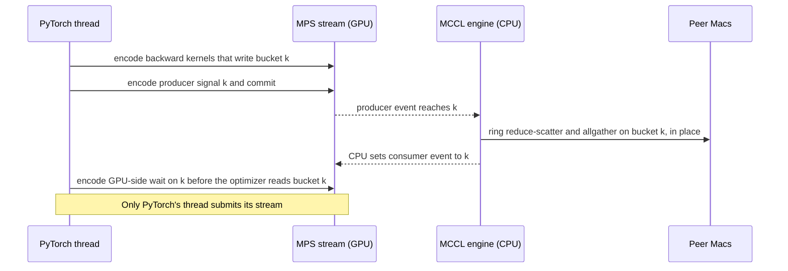

# MCCL (Metal Collective Communication Library)

[](https://github.com/mps-ddp/mccl/actions/workflows/ci.yml)
[](https://pypi.org/project/mccl/)
[](https://pypi.org/project/mccl/)
[](https://github.com/mps-ddp/mccl/blob/master/LICENSE)

MCCL is a `torch.distributed` backend for Apple-silicon GPUs. Training code selects it
with `backend="mccl"`. It runs multi-node PyTorch over Ethernet, and has been run on up
to 24 Macs at Skywalker Sound.

PyTorch has no distributed backend for MPS tensors, and Gloo accepts only CPU tensors, so
a Gloo run copies every gradient bucket to CPU after a device synchronization. MCCL
reduces gradients in place in unified memory and uses Metal shared events to order that
work against PyTorch's MPS stream, so the allreduce overlaps the backward pass.

## Performance

Measured on 24 Mac Studios at Skywalker Sound (M4 Max, 40-core GPU, 128 GB), one 10 GbE
switch, jumbo frames, MCCL 6.8.0, and PyTorch 2.14.

| Measurement | Result |
| --- | --- |
| 256 MB allreduce, 4–24 Macs | 99.7% of TCP goodput at 24 Macs (1.234 GB/s bus bandwidth) |
| Communication hidden behind gradient computation (25 MB buckets) | 94% at 4, 8, 16, and 24 Macs |
| 113.5M-parameter ViT on CIFAR-10, 1 → 24 Macs | 198 → 4,568 samples/s (95.9% scaling efficiency; 1.78× CPU-staged Gloo) |
| Same ViT on A100 80 GB GPUs | 1,088 samples/s on one GPU and 2,028 on two with TF32 matmul (24 Macs are 2.25× that two-GPU run). One A100 with fp32 matmul reaches 340 samples/s |
| 31.6M-parameter ResNet on CIFAR-10, 400 steps, batch 64 per Mac | 42.0% validation accuracy on 1 Mac, 63.2% on 24 |
| 10-minute soak at 24 Macs | 17,784 allreduces per rank, zero incorrect elements |
| CPU cost at line rate | 0.31 cores |

<p align="center">
  
  
</p>

## Installation

Requires an Apple-silicon Mac, macOS 15 or 26, Python 3.11–3.13, and PyTorch 2.13 or 2.14.

```bash
pip install torch==2.14.0   # PyPI wheels are built against PyTorch 2.14
pip install mccl
```

To build from source, install the Xcode Command Line Tools (`xcode-select --install`), then
run `pip install -e ".[dev]" --no-build-isolation` in a clone of this repository so the
extension builds against your installed PyTorch.

## Quick start

```python
import torch
import torch.distributed as dist
from torch.nn.parallel import DistributedDataParallel as DDP
import mccl  # registers the "mccl" backend

dist.init_process_group(backend="mccl", device_id=torch.device("mps:0"))
model = DDP(torch.nn.Linear(512, 10).to("mps"))
opt = torch.optim.AdamW(model.parameters(), lr=1e-3)

for step in range(10):
    loss = model(torch.randn(8, 512, device="mps")).square().mean()
    opt.zero_grad()
    loss.backward()
    opt.step()

dist.destroy_process_group()
```

Test on one Mac with two ranks, then run one rank per Mac with the same `MASTER_ADDR` and
`MASTER_PORT` on every node:

```bash
torchrun --nproc_per_node=2 --master_addr=127.0.0.1 --master_port=29500 train.py

MCCL_IFNAME=en0 torchrun --nnodes=4 --nproc_per_node=1 --node_rank=$NODE_RANK \
  --master_addr=10.0.0.10 --master_port=29500 train.py
```

`MCCL_IFNAME` selects the training interface on Macs with more than one network interface.
The results above used these settings on every Mac, with jumbo frames enabled on the switch:

| Setting | Value |
| --- | --- |
| Interface MTU | 9000 |
| `kern.ipc.maxsockbuf` | 32 MiB |
| `net.inet.tcp.autorcvbufmax`, `net.inet.tcp.autosndbufmax` | 32 MiB |
| `kern.ipc.somaxconn` | 2048 |
| `net.inet.tcp.delayed_ack` | 0 |

See [docs/MULTINODE.md](https://github.com/mps-ddp/mccl/blob/master/docs/MULTINODE.md) for
the multi-node checklist and troubleshooting, and
[docs/THUNDERBOLT_SETUP.md](https://github.com/mps-ddp/mccl/blob/master/docs/THUNDERBOLT_SETUP.md)
for Thunderbolt networking.

## How it works

**In-place reduction.** On shared MPS storage, MCCL sends from and reduces into each gradient
bucket's own Metal buffer using Accelerate, with fp16 and bf16 accumulated in fp32. Gradients
are not staged through host memory or copied back to the GPU.

**Shared-event ordering.** The CPU engine starts on a bucket as soon as its GPU producers
finish, and later GPU work waits for the reduced result. MCCL never submits PyTorch's MPS
stream or drains the device, which is what allows communication to overlap backward.



**TCP transport.** Large allreduces use a pipelined reduce-scatter/allgather ring and small
ones use recursive doubling. Per-peer reader threads, credit-based flow control, and
issue-order admission keep every rank on the same schedule.

Supported collectives: `allreduce`, `broadcast`, `allgather`, `reduce_scatter`, `barrier`,
`send`, and `recv`.

## Configuration

MCCL runs with its defaults, which are the settings behind the results above. The settings
you are most likely to need, set on every rank:

- `MCCL_IFNAME=en0` selects the network interface on Macs with more than one.
- `MCCL_PORT_BASE=20100` sets the first listen port (rank *r* uses `base + r`).
- `MCCL_LOG_LEVEL=INFO` logs the selected interface, address, MTU, and link speed at startup.

See [docs/CONFIGURATION.md](https://github.com/mps-ddp/mccl/blob/master/docs/CONFIGURATION.md)
for every setting.

## Diagnostics and testing

`mccl.get_metrics()` and `mccl.log_metrics()` report per-collective counters and latencies,
and `python tests/bench_busbw.py` measures algorithm and bus bandwidth by message size. CI
builds the extension and runs a two-rank DDP smoke test and an in-flight collectives check.
Locally, `pytest tests -m "not slow"` runs the broader suite, which launches several ranks
per Mac, withholds implicit GPU synchronization, and checks every output element exactly.

## Known issue: MPS reflect-padding gradients

On PyTorch 2.14 and macOS 15.7, the MPS backward pass of reflect padding is exact up to
65,535 samples (2¹⁶ − 1), silently returns wrong gradients above 2¹⁶ samples for single-channel
inputs (except at exact multiples of 2¹⁶), and fails at every length ≥ 2¹⁶ when batch or
channel count exceeds one. Centered `torch.stft` pads a batch as channels, so spectral
losses on clips longer than about 1.4 s at 48 kHz train on wrong gradients with no error or
NaN. Validate GPU losses against a CPU reference; `mccl.transforms.stft(..., backend="vdsp")`
is an independent Accelerate implementation suitable for that check.

## Limitations

The in-place path requires shared MPS storage, the PyTorch 2.14 default. Private storage
falls back to a staged path.

## Citation

If you use MCCL, please cite:

```bibtex
@software{sasso2026mccl,
  author  = {Sasso, Kevin},
  title   = {{MCCL} (Metal Collective Communication Library)},
  year    = {2026},
  version = {6.8.0},
  url     = {https://github.com/mps-ddp/mccl}
}
```

## License

MIT. See [LICENSE](https://github.com/mps-ddp/mccl/blob/master/LICENSE).
