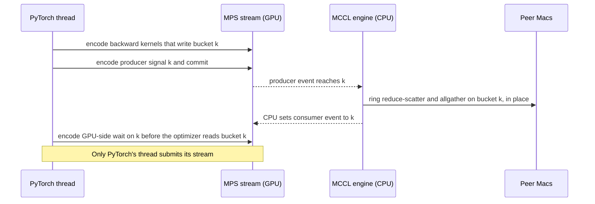

# MCCL

[](https://github.com/mps-ddp/mccl/actions/workflows/ci.yml)
[](https://pypi.org/project/mccl/)
[](https://pypi.org/project/mccl/)
[](https://github.com/mps-ddp/mccl/blob/master/LICENSE)

MCCL is a `torch.distributed` backend for Apple-silicon GPUs. It runs PyTorch DDP across
Macs over standard Ethernet, and existing training code needs only `backend="mccl"`.

PyTorch has no built-in distributed backend for MPS tensors, and Gloo accepts only CPU
tensors, so every gradient bucket must be staged through host memory after a device
synchronization. MCCL reduces gradients in place in unified memory and uses Metal shared
events to order that work against PyTorch's MPS stream, so communication overlaps the
backward pass.

## Performance

MCCL has run DDP jobs on up to 24 Macs, including full training runs to convergence. The
measurements below come from a controlled pool of 15 Mac Studios (M4 Max, 40-core GPU,
128 GB) on one 10 GbE switch with jumbo frames, using MCCL 6.8.0 and PyTorch 2.14.

| Measurement | Result |
| --- | --- |
| 256 MB allreduce, averaged over 4–15 Macs | 99.7% of TCP goodput (1.234 GB/s bus bandwidth) |
| Communication hidden behind backward (25 MB DDP buckets) | 94% at 4, 8, and 15 Macs |
| 113.5M-parameter ViT on CIFAR-10, 1 → 15 Macs | 199 → 2,875 samples/s (96.5% scaling efficiency) |
| 10-minute soak at 15 Macs | 18,884 allreduces per rank, zero incorrect elements |
| CPU cost at line rate | about 0.25 of one core |

<p align="center">
  
  
</p>

## Installation

Requires an Apple-silicon Mac, macOS 15 or 26, Python 3.11–3.13, and PyTorch 2.13 or 2.14.

```bash
pip install torch==2.14.0   # PyPI wheels are built against PyTorch 2.14
pip install mccl
```

To build from source, install the Xcode Command Line Tools (`xcode-select --install`), then
run `pip install -e ".[dev]" --no-build-isolation` in a clone of this repository so the
extension builds against your installed PyTorch.

## Quick start

```python
import torch
import torch.distributed as dist
from torch.nn.parallel import DistributedDataParallel as DDP
import mccl  # registers the "mccl" backend

dist.init_process_group(backend="mccl", device_id=torch.device("mps:0"))
model = DDP(torch.nn.Linear(512, 10).to("mps"))
opt = torch.optim.AdamW(model.parameters(), lr=1e-3)

for step in range(10):
    loss = model(torch.randn(8, 512, device="mps")).square().mean()
    opt.zero_grad()
    loss.backward()
    opt.step()

dist.destroy_process_group()
```

Test on one Mac with two ranks, then run one rank per Mac with the same `MASTER_ADDR` and
`MASTER_PORT` on every node:

```bash
torchrun --nproc_per_node=2 --master_addr=127.0.0.1 --master_port=29500 train.py

MCCL_IFNAME=en0 torchrun --nnodes=4 --nproc_per_node=1 --node_rank=$NODE_RANK \
  --master_addr=10.0.0.10 --master_port=29500 train.py
```

`MCCL_IFNAME` selects the training interface on Macs with more than one network interface.
The results above used these settings on every Mac, with jumbo frames enabled on the switch:

| Setting | Value |
| --- | --- |
| Interface MTU | 9000 |
| `kern.ipc.maxsockbuf` | 32 MiB |
| `net.inet.tcp.autorcvbufmax`, `net.inet.tcp.autosndbufmax` | 32 MiB |
| `kern.ipc.somaxconn` | 2048 |
| `net.inet.tcp.delayed_ack` | 0 |

See [docs/MULTINODE.md](https://github.com/mps-ddp/mccl/blob/master/docs/MULTINODE.md) for
the multi-node checklist and troubleshooting, and
[docs/THUNDERBOLT_SETUP.md](https://github.com/mps-ddp/mccl/blob/master/docs/THUNDERBOLT_SETUP.md)
for Thunderbolt networking.

## How it works

**In-place reduction.** On shared MPS storage, MCCL sends from and reduces into each gradient
bucket's own Metal buffer using Accelerate, with fp16 and bf16 accumulated in fp32. Gradients
are not staged through host memory or copied back to the GPU.

**Shared-event ordering.** The CPU engine starts on a bucket as soon as its GPU producers
finish, and later GPU work waits for the reduced result. MCCL never submits PyTorch's MPS
stream or drains the device, which is what allows communication to overlap backward.



**TCP transport.** Large allreduces use a pipelined reduce-scatter/allgather ring and small
ones use recursive doubling. Per-peer reader threads, credit-based flow control, and
issue-order admission keep every rank on the same schedule.

Supported collectives: `allreduce`, `broadcast`, `allgather`, `reduce_scatter`, `barrier`,
`send`, and `recv`.

## Configuration

MCCL runs with its defaults, which are the settings behind the results above. The settings
you are most likely to need, set on every rank:

- `MCCL_IFNAME=en0` selects the network interface on Macs with more than one.
- `MCCL_PORT_BASE=20100` sets the first listen port (rank *r* uses `base + r`).
- `MCCL_LOG_LEVEL=INFO` logs the selected interface, address, MTU, and link speed at startup.

See [docs/CONFIGURATION.md](https://github.com/mps-ddp/mccl/blob/master/docs/CONFIGURATION.md)
for every setting.

## Diagnostics and testing

`mccl.get_metrics()` and `mccl.log_metrics()` report per-collective counters and latencies,
and `python tests/bench_busbw.py` measures algorithm and bus bandwidth by message size. CI
builds the extension and runs a two-rank DDP smoke test and an in-flight collectives check.
Locally, `pytest tests -m "not slow"` runs the broader suite, which launches several ranks
per Mac, withholds implicit GPU synchronization, and checks every output element exactly.

## Known issue: MPS reflect-padding gradients

On PyTorch 2.14 and macOS 15.7, the MPS backward pass of reflect padding silently returns
wrong gradients for inputs longer than 2¹⁶ samples, or from 2¹⁶ for multi-channel inputs.
Centered `torch.stft` pads a batch as channels, so batched spectral losses on clips longer
than about 1.4 s at 48 kHz train on wrong gradients with no error or NaN. Validate GPU losses
against a CPU reference; `mccl.transforms.stft(..., backend="vdsp")` is an independent
Accelerate implementation suitable for that check.

## Limitations

- Small collectives are bound by network latency. With a 563 µs median TCP round trip, a
  1 MB allreduce at 15 Macs reaches 13% of goodput.
- MCCL uses a flat ring. A latency model fit to the 4–15-Mac measurements predicts that
  25 MB buckets become latency-bound near 65 Macs; hierarchical allreduce is not yet
  implemented.
- The in-place path requires shared MPS storage, the PyTorch 2.14 default. Private storage
  falls back to a staged path.

## Paper

An experience paper on MCCL's design and evaluation is forthcoming. The preprint link will
be added here.

## License

MIT. See [LICENSE](https://github.com/mps-ddp/mccl/blob/master/LICENSE).
