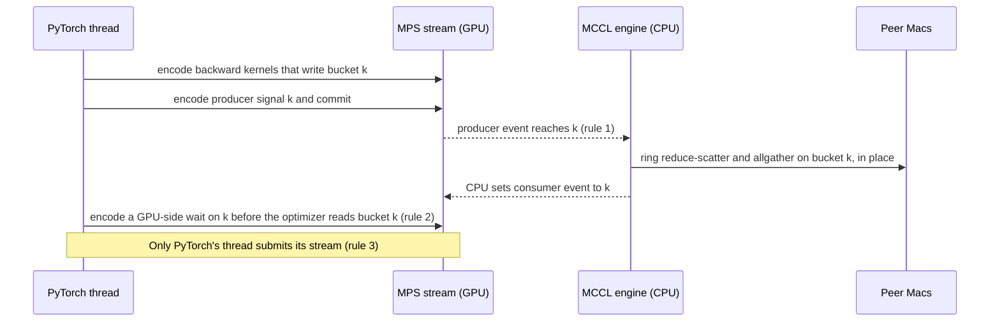

# MCCL

[](https://github.com/mps-ddp/mccl/actions/workflows/ci.yml)
[](https://pypi.org/project/mccl/)
[](https://pypi.org/project/mccl/)
[](https://github.com/mps-ddp/mccl/blob/master/LICENSE)

**Distributed PyTorch training across Apple-silicon Macs.** MCCL is a `torch.distributed`
backend for Apple GPU (MPS) tensors. Existing DDP training code runs across Macs over
ordinary Ethernet; the only change is the backend name.

```python
import mccl  # registers the "mccl" backend
torch.distributed.init_process_group(backend="mccl", device_id=torch.device("mps:0"))
```

Stock PyTorch has no distributed backend for MPS. Gloo accepts only CPU tensors, so every
gradient bucket is copied through host memory after a device synchronization, which also
keeps communication from overlapping the backward pass. MCCL sends and reduces each gradient
where the GPU wrote it, in unified memory, and orders that CPU work against PyTorch's MPS
stream with Metal shared events, so communication overlaps backward.

## Results

Measured on 15 Mac Studios (M4 Max, 40-core GPU, 128 GB unified memory) on one 10 GbE
switch with 9000-byte frames, using MCCL 6.8.0 and PyTorch 2.14.

- **Allreduce runs at line rate.** Across 4 to 15 Macs, a 256 MB allreduce averages
  **99.7% of TCP goodput** (1.234 of 1.238 GB/s bus bandwidth). 16 MB and 64 MB average
  97.6% and 99.3%.
- **Communication hides behind backward.** In a DDP-shaped step with 18 buckets of 25 MB,
  **94% of communication overlaps GPU work** at 4, 8, and 15 Macs. At 15 Macs the step takes
  4% longer than computation alone, versus 67% longer when serialized.
- **Training scales near-linearly.** A 113.5M-parameter ViT on CIFAR-10 (batch 256 per Mac,
  fixed 160-step throughput benchmark) goes from 199 samples/s on one Mac to 2,875 samples/s
  on 15: **96.5% scaling efficiency**.
- **Exact under stress.** A 10-minute 15-Mac soak completed 18,884 mixed-size allreduces per
  rank (0.36 TB) with zero incorrect elements. Delayed-synchronization burst tests at 2, 4,
  and 15 Macs completed 640 operations per rank with zero wrong results.
- **Cheap on the CPU.** At line rate, MCCL uses about a quarter of one CPU core.

<p align="center">
  
</p>
<p align="center">
  
</p>
<p align="center">
  
</p>

Small messages are bound by latency, not bandwidth. The median Mac-to-Mac TCP round trip on
our switch is 563 µs, so at 15 Macs a 1 MB allreduce reaches only 13% of goodput. DDP's
default 25 MB buckets stay near line rate through 15 Macs; a latency model fit to these
measurements puts their limit near 65 Macs.

The design, the full evaluation, and the failures we hit while deploying MCCL are described
in our experience paper. The preprint link will be posted here.

## How it works

**One copy in unified memory.** Apple GPUs share physical memory with the CPU. For a shared
MPS buffer, MCCL hands TCP a pointer into the gradient bucket and adds incoming chunks into
that same allocation with Accelerate (vDSP); half-precision values accumulate in fp32 at each
hop. Nothing is staged through host memory or copied back to the GPU. Private buffers fall
back to a staged path.

**Shared-event handoff.** Reducing GPU memory on CPU threads is only safe if three rules hold:

1. The engine reads a bucket only after all of its GPU producers finish.
2. Later GPU consumers, such as the optimizer, run only after the engine's final write.
3. Only PyTorch's thread submits PyTorch's MPS command stream.

MCCL enforces them with two Metal shared events and monotonic counters:



Draining the GPU before every bucket would also satisfy the first two rules, but it would
serialize communication behind computation.

**Transport over plain TCP.** Large allreduces use a pipelined reduce-scatter/allgather ring;
allreduces of 256 KiB or less use recursive doubling. A reader thread per peer parks
early-arriving messages in a bounded buffer, credits bound how far a sender can run ahead of
a slow receiver, every rank admits collectives in DDP's issue order, and macOS socket-buffer
exhaustion (`ENOBUFS`) is treated as back-pressure rather than a dead connection.

Supported collectives: `allreduce`, `broadcast`, `allgather`, `reduce_scatter`, `barrier`,
`send`, and `recv`.

## Install

Requirements: an Apple-silicon Mac (M1 through M4), macOS 15 or 26, Python 3.11 to 3.13, and
PyTorch 2.13 or 2.14.

```bash
pip install torch==2.14.0   # the PyPI wheels are built against PyTorch 2.14
pip install mccl
```

To build from source, install the Xcode Command Line Tools (`xcode-select --install`), then:

```bash
git clone https://github.com/mps-ddp/mccl && cd mccl
pip install torch==2.14.0
pip install -e ".[dev]" --no-build-isolation
```

`--no-build-isolation` builds against the PyTorch you installed, which the extension must
match. Full Xcode is optional: without `xcrun metal`, the Metal shaders compile at runtime
instead of shipping precompiled.

## Quick start

A minimal DDP script:

```python
import os
import torch
import torch.nn as nn
import torch.distributed as dist
from torch.nn.parallel import DistributedDataParallel as DDP
import mccl

def main():
    rank = int(os.environ["RANK"])
    device = torch.device("mps:0")
    dist.init_process_group(backend="mccl", device_id=device)

    torch.manual_seed(42)
    model = nn.Sequential(nn.Linear(512, 256), nn.ReLU(), nn.Linear(256, 10)).to(device)
    ddp_model = DDP(model)
    optimizer = torch.optim.AdamW(ddp_model.parameters(), lr=1e-3)
    loss_fn = nn.CrossEntropyLoss()

    for step in range(10):
        x = torch.randn(8, 512, device=device)
        y = torch.randint(0, 10, (8,), device=device)
        optimizer.zero_grad(set_to_none=True)
        loss_fn(ddp_model(x), y).backward()
        optimizer.step()
        if rank == 0:
            print(step, "ok")

    dist.destroy_process_group()

if __name__ == "__main__":
    main()
```

Run two ranks on one Mac:

```bash
torchrun --nproc_per_node=2 --nnodes=1 --master_addr=127.0.0.1 --master_port=29500 train.py
```

Two ranks on one Mac share one GPU, so this checks correctness, not speed.
[`examples/ddp_dummy_train.py`](https://github.com/mps-ddp/mccl/blob/master/examples/ddp_dummy_train.py)
is a fuller example that records throughput.

## Multiple Macs

Run one process per Mac with the usual `torchrun` flags and the same `MASTER_ADDR` and
`MASTER_PORT` everywhere:

```bash
# NODE_RANK is 0 on the Mac at MASTER_ADDR and 1..N-1 on the others
MCCL_IFNAME=en0 torchrun --nnodes=4 --nproc_per_node=1 --node_rank=$NODE_RANK \
  --master_addr=10.0.0.10 --master_port=29500 train.py
```

If a Mac has more than one network interface, set `MCCL_IFNAME` to the training network's
interface; otherwise MCCL uses the interface on `MASTER_ADDR`'s subnet.

The 15-Mac results above used these settings on every Mac, with jumbo frames enabled on the
switch:

| Setting | Value |
| --- | --- |
| Interface MTU | 9000 |
| `kern.ipc.maxsockbuf` | 32 MiB |
| `net.inet.tcp.autorcvbufmax`, `net.inet.tcp.autosndbufmax` | 32 MiB |
| `kern.ipc.somaxconn` | 2048 |
| `net.inet.tcp.delayed_ack` | 0 (off) |

Checklist and troubleshooting:
[docs/MULTINODE.md](https://github.com/mps-ddp/mccl/blob/master/docs/MULTINODE.md).
Thunderbolt cabling:
[docs/THUNDERBOLT_SETUP.md](https://github.com/mps-ddp/mccl/blob/master/docs/THUNDERBOLT_SETUP.md).

## Configuration

The defaults are what the results above used, so most jobs need no settings. Set variables
on every rank, or call `mccl.init(...)` before `init_process_group`.

| Variable | Default | Effect |
| --- | --- | --- |
| `MCCL_IFNAME` | unset | Interface to bind and publish (for example `en0`). Unset: the interface on `MASTER_ADDR`'s subnet. |
| `MCCL_PORT_BASE` | `20100` | Rank *r* listens on `base + r`. Keep it clear of `MASTER_PORT`. |
| `MCCL_LOG_LEVEL` | `WARN` | `INFO` logs the chosen interface, IP address, MTU, and link speed at startup. |
| `MCCL_SMALL_MSG_THRESHOLD` | 256 KiB | Allreduces at or below this size use recursive doubling; larger ones use the ring. |
| `MCCL_SOCK_BUFSIZE` | 32 MiB | Socket buffer size. `0` lets the kernel auto-tune. |
| `MCCL_CHUNK_BYTES` | 16 MB | Largest message on the wire. |
| `MCCL_COMPRESSION` | `none` | `fp16` or `topk` gradient compression (`MCCL_TOPK_RATIO` sets the kept fraction). |
| `MCCL_WATCHDOG_TIMEOUT_MS` | 300000 | Hang detector. The clock starts when an operation begins executing, not when it is queued. |
| `MCCL_TRANSPORT` | `auto` | `tcp` or `rdma`. RDMA over Thunderbolt 5 is experimental; all results above use TCP. |

<details>
<summary>All settings</summary>

| Variable | Default | Effect |
| --- | --- | --- |
| `MCCL_LISTEN_ADDR` | auto | Address to publish to peers, overriding interface selection. |
| `MCCL_RING_ALGO` | `auto` (`chunked`) | `chunked`: double-buffered ring with 2N chunks. `basic`: plain ring. |
| `MCCL_RING_PIPELINE` | on | Streaming send/receive ring. `0` is a lock-step fallback for debugging. |
| `MCCL_PIPELINE_DEPTH` | `4` | Receives posted ahead per ring pipeline (1 to 8). Memory cost is depth × chunk. |
| `MCCL_PIPELINE_INFLIGHT_BYTES` | 8 MB | Caps the effective depth at budget ÷ chunk (minimum 1) so large chunks don't pile up in the kernel and trigger `ENOBUFS`. |
| `MCCL_CREDIT_MIN_CHUNK` | 1 MB | Chunks at or above this size use credit flow control: a sender runs at most depth + 2 steps ahead of its receiver. `0` disables it. |
| `MCCL_COLLECTIVE_CONCURRENCY` | `1` | Collectives in flight (1 to 8). The ceiling is `MCCL_MAX_COLLECTIVE_CONCURRENCY` (default 8). |
| `MCCL_CONCURRENT_RINGS` | off | Lets ring allreduces share the wire, so bucket k+1 starts while bucket k drains. Needs `MCCL_COLLECTIVE_CONCURRENCY` of 2 or more. |
| `MCCL_DEMUX_PARK_BYTES` | auto (up to 4 GiB) | Per-peer bound on messages buffered before their receive is posted. |
| `MCCL_DEMUX_INFLIGHT_BUDGET_BYTES` | 1 GiB | Caps the effective concurrency at budget ÷ DDP bucket size. |
| `MCCL_SMALL_ALGO` | `tree` | Small-allreduce algorithm at world size 3 or more. `tree`: recursive doubling, log₂N rounds (plus 2 beyond a power of two). `star`: rank 0 serves each peer in turn. Compression and private storage always use `star`. |
| `MCCL_UNIFIED_COLLECTIVE` | on | Reduce shared MPS storage in place. `0` stages through Metal blits. |
| `MCCL_UNIFIED_CPU_REDUCE` | on | Reduce shared fp32, fp16, and bf16 chunks with vDSP in unified memory (fp16 and bf16 accumulate in fp32). `0` uses Metal kernels. |
| `MCCL_FP32_CPU_REDUCE` | off | Force fp32 CPU reduction on every path. |
| `MCCL_EVENT_SYNC` | on | `0` replaces shared-event ordering with a blocking stream sync. For debugging; it removes overlap. |
| `MCCL_OVERLAP_COMM` | on | Overlap communication with computation. |
| `MCCL_CPU_WRITE_SYNC` | none | `full` adds `torch.mps.synchronize()` after CPU-path collectives. For debugging; it serializes buckets. |
| `MCCL_COLLECTIVE_STORE_BARRIER` | off | TCPStore barrier before every collective. For debugging; it costs N−1 store round trips per collective. |
| `MCCL_TRANSPORT_CRC` | off | CRC32 on every payload. |
| `MCCL_FAST_MATH` | on | Metal fast math. `0` selects strict math. |
| `MCCL_LINK_PROFILE` | unset | `thunderbolt` uses transport chunks of at least 16 MB when `MCCL_CHUNK_BYTES` is unset. |
| `MCCL_TCP_LOWAT` | unset | Socket low-water mark (see `csrc/transport/Connection.cpp`). |
| `MCCL_STFT_BACKEND` | `auto` | Backend for `mccl.transforms.stft`: `vdsp`, `metal`, or `auto`. |

</details>

## Diagnostics and benchmarks

```python
mccl.get_metrics()    # snapshot of collective counters and latencies
mccl.log_metrics()    # print the summary
mccl.reset_metrics()
```

`MCCL_LOG_LEVEL=INFO` logs startup details, and the watchdog names the stuck operation if a
job hangs. `python tests/bench_busbw.py` reports NCCL-style algorithm and bus bandwidth for
each message size, plus an overlap-efficiency figure.

## Testing

Near-line-rate bandwidth was the easy part. The bugs that cost us most were quiet: ranks
admitting collectives in different orders, and CPU receives racing GPU work still queued on
memory the allocator had already reused. Ordinary tests hide both, because something in them,
such as printing a loss, flushes the MPS stream. MCCL's tests withhold every implicit
synchronization, use exactly representable values, check every output element, and sweep
full rank counts.

CI runs the build check, a two-rank DDP smoke test, and
`tests/test_inflight_small_collectives.py`. Locally, `pytest tests -m "not slow"` runs the
broader suite; most tests launch several ranks on one Mac.

## Known issue: MPS reflect-padding gradients (affects `torch.stft` losses)

While deploying MCCL we found that PyTorch's MPS backward pass for reflect padding silently
returns wrong gradients on long inputs (PyTorch 2.14, macOS 15.7). Every layout is exact below
2¹⁶ samples. Beyond that, single-channel inputs are wrong except at exact multiples of 2¹⁶,
and multi-channel inputs are wrong from 2¹⁶ on. `torch.stft(center=True)` pads a batch of
clips as channels, so batched spectral losses break at about 1.4 s of 48 kHz audio. There is
no error and no NaN: in a waveform-recovery test, the loss rose from 1.82 to 5.53 while the
CPU reference fell to 0.92.

If you train with spectral losses, compare GPU gradients against a CPU reference before
scaling out. `mccl.transforms.stft(..., backend="vdsp")` is an independent Accelerate
implementation that matches the CPU reference past 2¹⁶ samples; it is slower than Metal, so
treat it as a reference.

## Limitations

- Measured through 15 Macs on one switch. Larger clusters are untested; the latency model
  above predicts where a flat ring stops scaling, and a hierarchical allreduce is not
  implemented.
- Small collectives are bound by TCP round-trip latency on 10 GbE.
- Each Mac contributes one GPU, and PyTorch drives it through a single MPS command stream.
- The in-place path needs shared MPS storage, which PyTorch 2.14 allocates by default.
  Private storage takes a slower staged path.
- RDMA over Thunderbolt 5 (`MCCL_TRANSPORT=rdma`) is experimental and needs `rdma_ctl enable`
  run once from Recovery.

## License

MIT. See [LICENSE](https://github.com/mps-ddp/mccl/blob/master/LICENSE).
